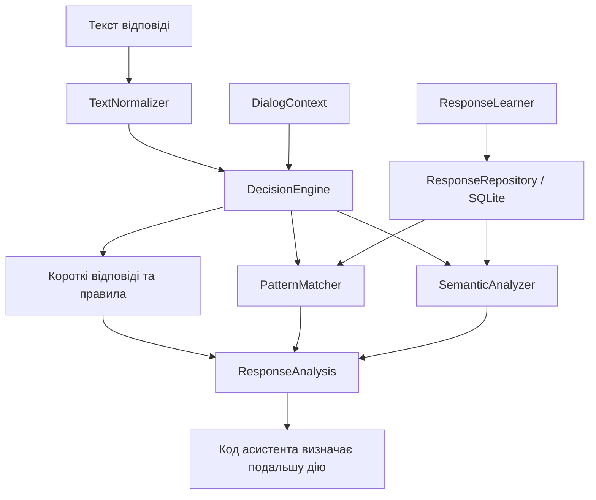

# Документація модуля `response_analysis`

## Призначення

Модуль `response_analysis` класифікує відповіді користувача на запитання асистента. Результат належить до однієї з категорій:

- `CONFIRMATION` — підтвердження;
- `REJECTION` — відмова;
- `UNKNOWN` — відповідь не вдалося класифікувати з достатньою впевненістю.

Модуль відповідає лише за аналіз тексту. Він не виконує дій з програмами: застосування результату визначає код, який викликав аналізатор.

## Потік роботи



`DecisionEngine` обробляє текст у такому порядку:

1. Нормалізує відповідь і перевіряє точний збіг короткої відповіді з патернами в БД.
2. Перевіряє відомі маркери невизначеності.
3. Якщо у фразі одночасно є маркери підтвердження й заперечення, класифікує її як відмову.
4. Перевіряє вбудовані фрази дозволу, наприклад «можеш відкрити».
5. Шукає збіг у збережених патернах.
6. Якщо патерн не знайдено, оцінює семантичну схожість.
7. Повертає `UNKNOWN`, якщо семантична оцінка не відповідає заданим порогам.

Результат містить категорію, рівень упевненості, за наявності — відповідний патерн, а також джерело класифікації.

## Основні можливості

- Класифікація коротких підтверджень і відмов за патернами в БД.
- Виявлення суперечливих маркерів у довшій відповіді, наприклад «так, але не зараз».
- Пошук збережених фраз і семантичне оцінювання, якщо точного патерна немає.
- Повернення `UNKNOWN`, якщо відповідь невизначена або оцінка недостатньо впевнена.
- Підготовка нових коротких фраз до збереження лише після підтвердження користувача.

## Основні компоненти

### `models.py` — типи даних

Файл визначає структури й перелічення, що використовуються модулем:

- `ResponseCategory` — категорія відповіді;
- `DialogState` — стан діалогу;
- `ResponseSource` — джерело результату: `RULE`, `PATTERN`, `SEMANTIC` або `UNKNOWN`;
- `DialogContext` — контекст запитання та перелік очікуваних категорій;
- `ResponseAnalysis` — результат класифікації;
- `ResponseCandidate` — фраза, яку можна запропонувати для збереження;
- `ResponsePattern` — запис патерна в таблиці SQLAlchemy.

Приклад результату:

```text
category        = CONFIRMATION
confidence      = 0.94
matched_pattern = "добре"
source          = SEMANTIC
```

### `config.py` — параметри аналізу

`ResponseAnalysisConfig` задає пороги семантичної класифікації, рівні впевненості для зіставлення патернів, допустиму довжину патерна та мінімальну відстань між оцінками категорій.

### `repository.py` — сховище патернів

`ResponseRepository` інкапсулює доступ до таблиці патернів через SQLAlchemy. Під час ініціалізації він створює таблицю, якщо її ще немає, та додає відсутні фрази базових підтверджень і відмов. Додавання є ідемпотентним, тому вже наявні патерни не дублюються.

Репозиторій надає операції отримання, створення, оновлення та видалення патернів, а також окремо записує відповіді-підтвердження й відповіді-відмови у таблиці `response_confirmations` і `response_rejections`. За замовчуванням використовується SQLite-файл `response_patterns.db`; шлях можна змінити через параметр `database_url`.

### `text_normalizer.py` — нормалізація тексту

`TextNormalizer` переводить текст у нижній регістр, нормалізує апостроф, прибирає частину пунктуації та зводить послідовності пробілів до одного пробілу. Наприклад:

```python
TextNormalizer.normalize("  ТАК!!! ")
# "так"
```

Нормалізація усуває відмінності форматування, але не виконує мовного аналізу.

### `pattern_matcher.py` — зіставлення зі збереженими фразами

`PatternMatcher` отримує патерни з репозиторію та порівнює їх із нормалізованою відповіддю. Підтримуються точний збіг і часткове входження одного рядка в інший. Для збігів повертається джерело `PATTERN`.

### `semantic_analyzer.py` — семантична оцінка

Якщо правила й патерни не визначили категорію, `SemanticAnalyzer` оцінює відповідь відносно збережених фраз:

1. Кодує відповідь і патерни у вектори.
2. Обчислює косинусну схожість за допомогою NumPy.
3. Порівнює оцінки з порогами конфігурації та повертає категорію лише за достатньої впевненості.

За наявності пакета `sentence-transformers` використовується модель `all-MiniLM-L6-v2`. Її завантаження може вплинути на час першого семантичного аналізу. Якщо модель недоступна, застосовується спрощене резервне подання на основі спільних слів. Резервний режим не є повноцінним розумінням мови.

### `decision_engine.py` — вибір результату

`DecisionEngine` поєднує патерни з БД, правила невизначеності й суперечливих сигналів, фрази дозволу та семантичний аналіз. Основні короткі підтвердження й відмови зберігаються в `response_patterns`; односимвольні «д» і «н» до початкового набору не входять. Керувальні фрази невизначеності та підтвердження дозволу залишаються в коді.

Наприклад, фраза «так, але не зараз» містить підтвердження та заперечення, тому класифікується як `REJECTION`. Відомі фрази невизначеності, наприклад «не знаю» або «можливо», повертають `UNKNOWN`.

### `response_analyzer.py` — інтерфейс аналізу

`ResponseAnalyzer.analyze(...)` приймає запитання, відповідь і необов’язковий `DialogContext`, після чого передає відповідь механізму `DecisionEngine`.

```python
result = analyzer.analyze(
    question="Відкрити програму?",
    answer="так",
    dialog_context=context,
)
```

Текст запитання передається інтерфейсом, але поточний `DecisionEngine` класифікує насамперед текст відповіді та враховує очікувані категорії з контексту. Семантичне тлумачення формулювання запитання не виконується.

### `response_learner.py` — кероване додавання фраз

`ResponseLearner.create_candidate(...)` може створити кандидата, якщо нормалізована фраза:

- не порожня;
- містить не більше чотирьох слів;
- має не більше 45 символів;
- ще не існує в репозиторії.

Створення кандидата не змінює базу даних. Патерн додається лише після виклику `accept_candidate(...)`. Відхилення пропозиції не додає патерн до `response_patterns`, але сама відповідь і рішення зберігаються окремо у `response_rejections`. Підтвердження зберігається у `response_confirmations`.

## Використання

У поточному голосовому сценарії асистент може запропонувати зберегти нову фразу, якщо вона класифікована як `SEMANTIC` і відповідає обмеженням кандидата. Поки користувач підтверджує або відхиляє збереження, початкова дія з програмою очікує.

Відповідь «ні» на запитання про збереження означає відмову від додавання патерна, а не скасування початкової дії. Якщо відповідь на запитання про дію або навчання має категорію `UNKNOWN`, асистент повторює відповідне запитання та не виконує дію до розпізнаної відповіді.

## Дані та збереження

Початкові патерни додаються лише тоді, коли таблиця `response_patterns` порожня:

| Категорія | Початкові фрази |
| --- | --- |
| `CONFIRMATION` | так, ага, угу, добре, звичайно, давай, можна |
| `REJECTION` | ні, не хочу, не треба, не потрібно, скасуй, я передумав |

Семантичні вектори не зберігаються в SQLite; вони формуються під час аналізу.

Класифіковані згоди та відмови з голосового потоку зберігаються окремо в `response_confirmations` і `response_rejections` разом із контекстом запитання, кандидатом та оцінкою впевненості. Таблиці створюються автоматично в `response_patterns.db`.

## Обмеження

- Модуль класифікує текст відповіді, але не тлумачить зміст запитання мовною моделлю.
- Правила для коротких відповідей і заперечень охоплюють лише явно перелічені фрази.
- Семантичний резервний режим на основі спільних слів є спрощеним і не забезпечує повноцінного розуміння мови.
- Класифікація не виконує дій самостійно; її результат має обробити викликач.

## Тестування та навігація

Основні модульні перевірки розміщені в `tests/test_response_analysis.py`. Сценарії взаємодії з асистентом перевіряються в `tests/test_run_assistant_response_flow.py`.

Основні файли модуля:

- Початкові патерни та робота зі сховищем — `repository.py`.
- Нормалізація тексту — `text_normalizer.py`.
- Зіставлення зі збереженими патернами — `pattern_matcher.py`.
- Семантичні вектори й оцінювання — `semantic_analyzer.py`.
- Короткі відповіді, заперечення та порядок класифікації — `decision_engine.py`.
- Обмеження кандидатів для навчання — `response_learner.py`.
- Структура результату — `models.py`, клас `ResponseAnalysis`.
