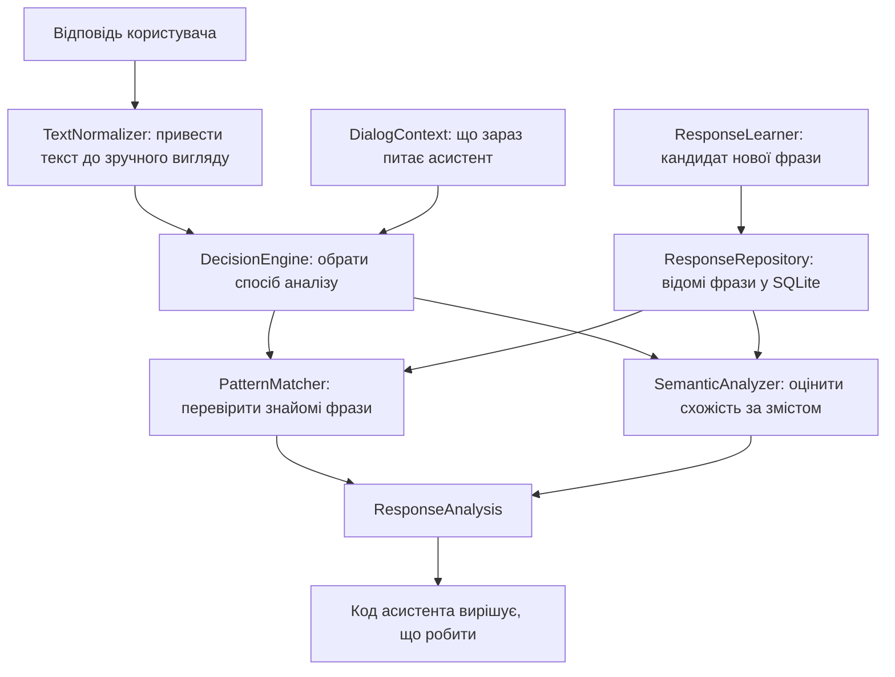

# Як працює `response_analysis`

## Навіщо цей модуль

Асистент ставить запитання на кшталт «Відкрити цю програму?», а у відповідь може почути не лише коротке «так» чи «ні», а й «ну добре, давай» або «та ні, я передумав».

Модуль `response_analysis` намагається визначити зміст відповіді та повертає один із трьох результатів:

- `CONFIRMATION` — користувач погоджується;
- `REJECTION` — користувач відмовляється;
- `UNKNOWN` — надійно визначити відповідь не вдалося.

Важливе розділення: модуль **розбирає відповідь**, але сам нічого не відкриває і не закриває. Інший код має вирішити, що робити з результатом.

## Загальна схема



Якщо коротко: спершу текст чиститься, потім шукається знайома відповідь, а якщо знайомої відповіді немає — пробується семантична оцінка. Наприкінці повертається результат із категорією та впевненістю.

## Як проходить одна відповідь

Уявімо, що асистент запитав: «Ви хочете додати програму?», а користувач сказав: «Ну добре, давай».

1. `TextNormalizer` прибирає зайві пробіли та приводить текст до нижнього регістру.
2. `DecisionEngine` перевіряє, чи не поєднані в тексті позитивні та негативні сигнали.
3. `PatternMatcher` шукає відому фразу в локальній базі.
4. Якщо відповідного патерна немає, `SemanticAnalyzer` порівнює embedding відповіді з embedding відомих фраз.
5. Результат повертається як `ResponseAnalysis`.
6. Асистент, а не аналізатор, вирішує, чи виконувати дію.

## Файли — людською мовою

### `models.py` — які дані використовує модуль

Тут описані основні поняття:

- `ResponseCategory` — згода, відмова або невідома відповідь;
- `DialogState` — чи асистент зараз чекає відповідь;
- `ResponseSource` — звідки взявся результат: зі словника, семантичного аналізу чи він невідомий;
- `DialogContext` — контекст поточної розмови: запитання, дія та очікувані категорії;
- `ResponseAnalysis` — готовий результат аналізу;
- `ResponseCandidate` — коротка нова фраза, яку можна запропонувати запам’ятати;
- `ResponsePattern` — рядок у SQLAlchemy-таблиці з відомою фразою.

`ResponseAnalysis` можна уявити як відповідь самого модуля:

```text
category       = CONFIRMATION
confidence     = 0.94
matched_pattern = "добре"
source         = SEMANTIC
```

### `config.py` — налаштування аналізу

Тут зібрані пороги впевненості та обмеження для нових патернів, наприклад максимальна кількість слів. Це місце, куди варто йти, якщо захочеться змінити суворість класифікації або дозволену довжину фрази.

### `repository.py` — розмова з базою даних

`ResponseRepository` — єдиний компонент, якому слід напряму працювати з SQLAlchemy-сесіями для патернів.

Коли створюється repository, він:

1. створює SQLite-таблицю, якщо її ще немає;
2. додає початкові фрази, якщо таблиця порожня.

Також він уміє знаходити, додавати, змінювати й видаляти патерни. Сам файл бази залежить від переданого `database_url`; якщо аргумент не передати, використовується `response_patterns.db`.

### `text_normalizer.py` — привести текст до одного вигляду

Наприклад, варіанти ` "  ТАК!!! " ` та ` "так" ` мають стати достатньо схожими, щоб їх можна було зіставляти.

```python
TextNormalizer.normalize("  ТАК!!! ")
# "так"
```

Це не розуміння мови, а лише прибирання дрібних відмінностей у написанні.

### `pattern_matcher.py` — спершу перевірити словник

Компонент завантажує відомі фрази через repository і шукає:

- точний збіг;
- короткий патерн, який міститься у відповіді, або навпаки.

Якщо патерн знайдений, результат має `source=PATTERN`. Це надійніше за припущення моделі, тому знайомі фрази перевіряються першими.

### `semantic_analyzer.py` — оцінити схожість за змістом

Якщо знайомий патерн не підійшов, цей компонент намагається порівняти відповідь із фразами зі словника:

1. отримує список патернів із repository;
2. кодує відповідь та патерни у вектори;
3. рахує cosine similarity через NumPy;
4. порівнює оцінки категорій із порогами з конфігурації.

Для embedding використовується Sentence Transformers. Модель `all-MiniLM-L6-v2` може завантажуватися під час першого семантичного аналізу, тому перший запуск може бути повільнішим.

У коді також є спрощений fallback на основі спільних слів, якщо модель недоступна. Це не повноцінне розуміння українських фраз: така оцінка значно простіша за sentence embeddings.

### `decision_engine.py` — звести сигнали до одного результату

Це місце, де поєднуються пошук патерна, семантична оцінка та базове виявлення заперечень.

Наприклад, для фрази «так, але не зараз» є і позитивний сигнал («так»), і негативний («не зараз»). Поточне правило надає перевагу відмові.

Порядок у поточній реалізації:

1. нормалізувати текст;
2. перевірити, чи є водночас позитивний і негативний маркер;
3. спробувати знайти знайомий патерн;
4. якщо патерн не знайдено — виконати семантичний аналіз;
5. повернути `UNKNOWN`, якщо результат недостатньо впевнений.

### `response_analyzer.py` — точка входу

Цей клас зручно викликати з коду асистента. Він приймає запитання, відповідь і контекст, а потім передає відповідь `DecisionEngine`.

```python
result = analyzer.analyze(
    question="Відкрити програму?",
    answer="так",
    dialog_context=context,
)

print(result.category)
```

Наразі сам текст `question` передається далі, але рішення приймається переважно за відповіддю та `expected_response_categories` із контексту. Саме по собі формулювання запитання ще не розбирається мовною моделлю.

### `response_learner.py` — підготувати нову фразу

Learner може створити `ResponseCandidate`, якщо фраза:

- не порожня;
- має не більше чотирьох слів;
- не довша за 45 символів;
- ще не збережена у словнику.

Створення candidate **не записує його в базу**. У голосовій команді кандидат пропонується користувачу лише тоді, коли відповідь класифікована як `SEMANTIC` і проходить обмеження короткої фрази. Для збереження користувач має явно підтвердити пропозицію; тоді викликається `accept_candidate(...)`. Відмова викликає `reject_candidate(...)` і не додає фразу до бази.

Поки користувач вирішує, чи запам’ятати фразу, дія з програмою ще не виконується. Після відповіді «так» або «ні» щодо навчання початкова дія продовжується: відповідь «ні» означає лише «не запам’ятовуй фразу», а не скасування відкриття/закриття програми.

Якщо аналізатор повертає `UNKNOWN`, голосова команда повторює поточне запитання і залишає його очікуваним. Дію не виконує, доки не отримає розпізнане підтвердження або відмову. Якщо відповідь на запитання про запам’ятовування теж `UNKNOWN`, повторюється саме це запитання; кандидат і початкова дія лишаються в очікуванні.

### `__init__.py` — що доступно з пакета

Цей файл експортує головні класи й типи. Завдяки цьому їх можна імпортувати коротко:

```python
from core.response_analysis import ResponseAnalyzer, ResponseRepository
```

## Що саме зберігається

Початкові фрази додаються в таблицю `response_patterns`, коли repository бачить, що вона порожня.

| Категорія | Початкові фрази |
|---|---|
| `CONFIRMATION` | так, ага, угу, добре, звичайно, давай, можна |
| `REJECTION` | ні, не хочу, не треба, не потрібно, скасуй, я передумав |

Embedding-и в SQLite не зберігаються: під час аналізу вектори створюються в пам’яті.

## Тести

Основні перевірки лежать у `tests/test_response_analysis.py`. Там перевіряються нормалізація, патерни, семантичний аналіз, заперечення та навчання коротких фраз.

## Якщо треба швидко знайти потрібне місце

- Змінити початкові слова — `repository.py`.
- Змінити очищення тексту — `text_normalizer.py`.
- Змінити пошук точного патерна — `pattern_matcher.py`.
- Змінити embedding або cosine similarity — `semantic_analyzer.py`.
- Змінити обробку «так, але ні» — `decision_engine.py`.
- Змінити довжину патерна — `config.py` і перевірку в `response_learner.py` / `repository.py`.
- Побачити, що саме повертається — `models.py`, клас `ResponseAnalysis`.
